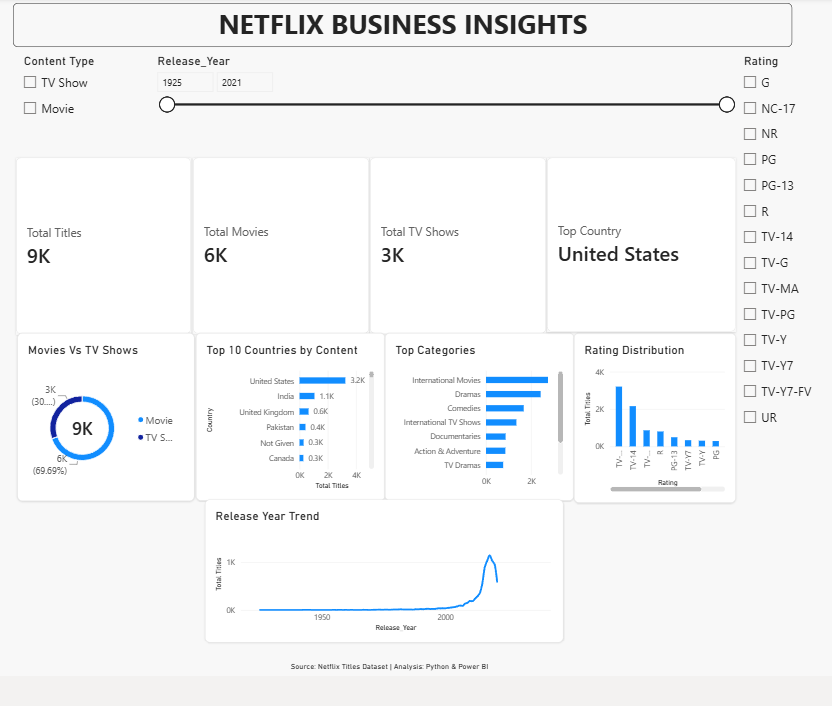

# Netflix Data Analysis | Python & Power BI

## Project Overview

This project explores Netflix movies and TV shows to understand the platform's content distribution, release trends, country-wise contributions, genres, and ratings.

The dataset was inspected and prepared for analysis, and an interactive Power BI dashboard was developed to present the findings through KPI cards and data visualizations.

The project demonstrates practical skills in data analysis, data preparation, visualization, and business insight communication.

## Objectives

- Analyze the distribution of movies and TV shows.
- Explore content release trends by year.
- Identify countries contributing the most titles.
- Examine the most common content categories.
- Understand the distribution of content ratings.
- Present key findings through an interactive Power BI dashboard.

## Dataset Overview

The dataset contains information about Netflix titles, including movies and TV shows.

**Dataset size:** 8,790 titles

- Movies: 6,126 (69.7%)
- TV Shows: 2,664 (30.3%)

### Dataset Columns

| Column | Description |
|---|---|
| `show_id` | Unique identifier for each title |
| `type` | Movie or TV Show |
| `title` | Title name |
| `director` | Director associated with the title |
| `country` | Country or countries associated with the title |
| `date_added` | Date the title was added to Netflix |
| `release_year` | Original release year |
| `rating` | Content rating classification |
| `duration` | Movie runtime or number of seasons |
| `listed_in` | Genre or category information |

**Dataset source:** Add the original dataset URL and attribution here.

## Tools and Technologies

- **Python:** Data inspection and preparation, where applicable
- **Pandas:** Data manipulation and analysis
- **Power BI Desktop:** Dashboard creation and data visualization
- **CSV:** Dataset storage and exchange
- **GitHub:** Project version control and portfolio presentation

## Project Workflow

### 1. Data Inspection and Preparation

- Loaded and examined the Netflix dataset.
- Reviewed the dataset structure, columns, and data types.
- Checked data quality issues relevant to the analysis.
- Prepared the dataset for visualization.

### 2. Exploratory Data Analysis

Explored the data to understand:

- Movie versus TV show distribution
- Content release-year trends
- Country-wise title distribution
- Common genres and categories
- Content rating distribution

### 3. Power BI Dashboard Development

Created a dashboard titled **NETFLIX BUSINESS INSIGHTS** with KPI cards and visualizations covering:

- Content type distribution
- Release-year trends
- Top 10 countries
- Top content categories
- Ratings distribution

The dashboard helps users explore the dataset and identify patterns in Netflix's content catalog.

## Key Findings

- **Movies dominate the catalog:** Movies account for approximately 69.7% of the dataset, while TV shows account for 30.3%.
- **United States leads by country:** The United States is the leading country in the dataset based on the country analysis.
- **Multiple dimensions of content:** Release years, categories, and ratings provide different perspectives on the composition of the catalog.

These findings describe the dataset analyzed in this project and should not be interpreted as current Netflix platform statistics.

## Dashboard Preview




## Repository Structure

```text
Netflix_Data_Analysis/
├── README.md
├── data/
│   └── Cleaned_Dataset.csv
├── notebooks/
│   └── data_cleaning.ipynb
│   └── content_type_analysis.ipynb
│   └── country-wise_content_analysis
│   └── netflix_business_insights_report.ipynb
├── dashboard/
│   └── Netflix_Dashboard.pbix
├── images/
│   └── Netflix-Dashboard.png
│   └── movie_durations_visual.png
│   └── rating_visual.png
│   └── genres_visual.png
│   └── countries_content_visual.png
│   └── release_year_visual.png
│   └── movies_vs_tv_shows.png
├── requirements.txt
└── .gitignore
└── LICENSE
```

## How to Use This Project

1. Clone or download this repository.
2. Open the CSV file in your preferred data analysis tool.
3. If a Python notebook is included, install its required dependencies and run the notebook.
4. Open the `.pbix` file using Power BI Desktop to explore the dashboard.
5. Review the dashboard visuals and findings documented in this README.

## Skills Demonstrated

- Data inspection and preparation
- Exploratory data analysis
- Data visualization
- Power BI dashboard development
- Business insight communication
- Analytical thinking and presentation

## Limitations

- The findings are based on the supplied dataset and do not necessarily reflect Netflix's current catalog.
- Country and genre fields may contain multiple values for a single title.
- The analysis describes patterns in the available data and does not establish causal relationships.

## Author

**Bushra Batool**

Software Engineering Graduate | Aspiring Data Analyst | AI/ML Engineer 

GitHub: https://github.com/bushraabbas2085

LinkedIn: https://www.linkedin.com/in/bushra-batool-1016ba367/

## Acknowledgements

Thanks to the original dataset creator and data provider. Please refer to the original dataset page for its license, attribution requirements, and usage conditions.
